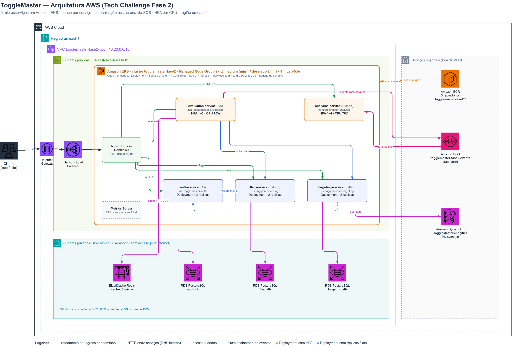

# Arquitetura — ToggleMaster Fase 2

## Visão geral

O monolito da Fase 1 foi substituído por cinco microsserviços, cada um dono dos seus dados,
rodando em Kubernetes (Amazon EKS). O tráfego externo entra por um único Network Load Balancer,
criado pelo Nginx Ingress Controller, e é roteado por caminho para o serviço correspondente.

| Serviço | Responsabilidade | Dados | Rota pública |
|---|---|---|---|
| auth-service (Go) | Emite e valida chaves de API | RDS PostgreSQL `auth_db` | `/auth/*` |
| flag-service (Python) | CRUD das feature flags | RDS PostgreSQL `flag_db` | `/flags` |
| targeting-service (Python) | Regras de segmentação (ex.: 50% dos usuários) | RDS PostgreSQL `targeting_db` | `/rules` |
| evaluation-service (Go) | Decisão final `true/false` — o caminho quente | ElastiCache Redis + SQS (produtor) | `/evaluate` |
| analytics-service (Python) | Consome eventos de avaliação e grava para análise | SQS (consumidor) + DynamoDB | `/analytics/*` (só health) |

### Fluxo de uma avaliação

1. O cliente chama `GET /evaluate?user_id=…&flag_name=…` no Load Balancer.
2. O evaluation-service procura a flag no **Redis**. Em cache miss, consulta o flag-service e o
   targeting-service em paralelo — ambos validam a chave de serviço no auth-service — e grava o
   resultado combinado no Redis por 30 segundos.
3. A regra é aplicada com hash determinístico (`SHA-1(user_id + flag) mod 100`): o mesmo usuário
   recebe sempre a mesma resposta.
4. A resposta volta ao cliente e, **sem bloquear a resposta**, um evento é publicado no **SQS**.
5. O analytics-service consome a fila em long polling, grava cada evento no **DynamoDB** e só então
   apaga a mensagem — se a gravação falhar, a mensagem volta para a fila.

## Decisões de arquitetura

### Um banco por serviço

Cada serviço com estado relacional tem seu próprio RDS. Nenhum serviço lê o banco de outro: o
evaluation-service obtém flags e regras pelas APIs, nunca por SQL. Isso permite evoluir o schema,
escalar e até trocar o banco de um serviço sem coordenar com os outros — o oposto do acoplamento
do monolito da Fase 1.

### Três tipos de armazenamento, três propósitos

| | RDS PostgreSQL | ElastiCache Redis | DynamoDB |
|---|---|---|---|
| **Modelo** | Relacional, SQL, transações ACID | Chave-valor em memória | NoSQL chave-valor/documento |
| **Papel no ToggleMaster** | Fonte da verdade de chaves, flags e regras | Cache do caminho quente | Histórico de eventos de avaliação |
| **Por quê** | Dados pequenos e críticos, com unicidade (`UNIQUE`), integridade e consultas por chave de negócio | Latência sub-milissegundo; dado descartável (TTL de 30 s) que pode ser reconstruído a partir do RDS | Volume alto de escrita só de inserção, sem joins; escala horizontal sem administrar servidor, cobrança por requisição |
| **Se perder os dados** | Perda real (configuração do produto) | Nenhum impacto além de alguns cache misses | Perda de histórico analítico, não afeta a operação |

Em resumo: o **RDS guarda o que é verdade**, o **Redis guarda o que é rápido** e o **DynamoDB
guarda o que é volumoso**.

### Comunicação assíncrona com SQS

A gravação de analytics não pode atrasar nem derrubar a avaliação. Com a fila no meio, o
evaluation-service responde em milissegundos mesmo que o DynamoDB esteja lento ou o
analytics-service esteja fora do ar — os eventos esperam na fila (retenção padrão de 4 dias) e
são processados quando o consumidor voltar.

### Kubernetes

- **Um namespace por serviço** (`togglemaster-auth`, `togglemaster-flag`, …): isolamento lógico,
  Secrets visíveis só para o próprio serviço e possibilidade de aplicar quotas e políticas de rede
  por serviço. A comunicação entre serviços usa o DNS completo
  (`auth-service.togglemaster-auth.svc.cluster.local`).
- **Um Ingress por namespace**: o recurso Ingress só referencia Services do próprio namespace. O
  Nginx Ingress Controller junta todos numa única configuração atrás do mesmo Load Balancer.
- **ConfigMap para configuração, Secret para credenciais**: URLs internas, portas e região ficam no
  ConfigMap; strings de conexão, chaves e endpoints dos recursos AWS ficam no Secret (base64). Os
  valores reais nunca vão para o Git — são gerados a partir dos recursos provisionados.
- **Requests e limits** em todos os containers, e **readiness/liveness probes** em `/health`.
- **Containers não-root**, sem escalonamento de privilégio e sem capabilities do Linux. As imagens
  Go usam `distroless/static` (sem shell nem gerenciador de pacotes, ≈ 20 MB).
- **Migração de schema como Job**: o `init.sql` de cada banco é aplicado por um Job separado, e não
  no boot do processo web. É a correção do principal débito técnico apontado na Fase 1 (fator XII
  do 12-Factor — processos administrativos como execuções pontuais).

### Escalabilidade

| Serviço | Réplicas | Mecanismo |
|---|---|---|
| auth, flag, targeting | 2 fixas | Alta disponibilidade (uma réplica por nó) |
| evaluation-service | 1 a 6 | HPA por CPU, alvo 70% |
| analytics-service | 1 a 4 | HPA por CPU, alvo 70% |

O **Metrics Server** coleta o uso de CPU dos pods; o HPA compara com o `request` de CPU e ajusta
as réplicas.

**Por que HPA por CPU no analytics-service, e não KEDA.** O ideal para um consumidor de fila é
escalar pelo tamanho da fila (`ApproximateNumberOfMessages`), o que o KEDA faz — inclusive
escalando a zero quando a fila está vazia. Mas o KEDA precisa ler métricas do SQS com uma IAM Role
própria (IRSA ou Pod Identity), e o AWS Academy **não permite criar roles**. A alternativa adotada
usa o fato de que a CPU do consumidor acompanha a fila: com mensagens acumuladas, o worker
processa sem pausa e a CPU sobe; com a fila vazia, ele fica bloqueado no long polling e a CPU cai.
A limitação é que a reação é indireta (o HPA só age depois que a CPU subiu) e o mínimo é 1 réplica,
nunca zero.

Validação local (cluster kind, 3 nós): 90 s de carga com `hey` a ≈ 730 req/s levaram o
evaluation-service de 1 a 6 réplicas, e o volume de eventos gerado levou o analytics-service de
1 a 4.

## Rede e segurança na AWS

- VPC própria da Fase 2 (`10.20.0.0/16`), separada da Fase 1, com 2 subnets públicas e 2 privadas
  em zonas de disponibilidade diferentes.
- **Nós do EKS nas subnets públicas**, com IP público, para baixar imagens do ECR sem NAT Gateway
  (≈ US$ 33/mês a menos). O Security Group do cluster só libera, de fora, as NodePorts do Ingress
  Controller — regras criadas e removidas automaticamente pelo Kubernetes junto com o Load
  Balancer. Em produção, os nós ficariam em subnets privadas atrás de NAT.
- **RDS e ElastiCache nas subnets privadas**, sem acesso público. Seus Security Groups aceitam
  conexões somente vindas do **Security Group do cluster EKS** — referência a Security Group, não a
  bloco de IP, o mesmo princípio aplicado na Fase 1.
- DynamoDB e SQS são acessados pela API pública da AWS, autenticados pela `LabRole` dos nós.

## Limitações do AWS Academy e como foram contornadas

| Limitação | Impacto | Contorno |
|---|---|---|
| Não é possível criar IAM Roles | Sem `eksctl create cluster`, sem IRSA/Pod Identity, sem KEDA, sem Karpenter, sem AWS Load Balancer Controller | Cluster e node group criados pelo console com a `LabRole`; HPA por CPU; Load Balancer criado pelo controlador nativo do Kubernetes (NLB) |
| Todos os pods herdam a `LabRole` do nó | Não há privilégio mínimo por serviço — qualquer pod pode acessar SQS e DynamoDB | Aceito no laboratório. Em produção: uma role por ServiceAccount (IRSA) |
| Nós criados com IMDSv2 e *hop limit* 1 | Só o próprio nó alcança o serviço de metadados; os pods ficavam sem as credenciais da `LabRole` (`NoCredentialProviders` no evaluation, `Unable to locate credentials` no analytics) e nenhum evento chegava ao SQS | `05-preparar-cluster.sh` e `nodes.sh ligar` sobem o *hop limit* para 2 em cada nó. Em produção, IRSA/Pod Identity dispensa o acesso dos pods aos metadados |
| Credenciais temporárias (~4 h) | Scripts e `kubectl` param de funcionar ao fim da sessão | Credenciais renovadas no `~/.aws/credentials` a cada sessão; os pods não dependem delas |
| Sem Cluster Autoscaler | O node group não cresce sozinho se faltar CPU para novos pods | Node group com 2 nós dimensionado para o pico do HPA (≈ 2 vCPU de requests no máximo) |
| Crédito de US$ 50 para o curso todo | O ambiente completo custa ≈ US$ 7,50 por dia ligado | Tudo validado localmente antes; infraestrutura criada, demonstrada e destruída no mesmo dia, por script |

## Ambiente local

O mesmo código roda localmente de duas formas, sem custo:

- **Docker Compose** — os 5 serviços com 2 PostgreSQL, Redis e DynamoDB Local (9 contêineres).
- **kind** — os mesmos manifestos Kubernetes do EKS, num cluster local de 3 nós, com Metrics Server
  e Nginx Ingress, para validar probes, rotas do Ingress e o HPA antes de gastar crédito.
