# Relatório de Entrega — Tech Challenge Fase 2

**Curso:** POSTECH — DevOps e Arquitetura Cloud (DCLT)
**Projeto:** ToggleMaster — Plataforma de Feature Flags
**Fase:** 02 — Microsserviços em contêineres e Kubernetes (AWS EKS)

---

## 1. Participantes

| Nome completo | RM | Discord |
|---|---|---|
| Lucas de Togni Souza | RM375772 | `_lucassx_` |
| Rafael Gamba Ramos | RM373722 | `rafa_217616` |

---

## 2. Links da entrega

**Vídeo de demonstração** — 14 min 57 s
<https://youtu.be/PdSF5AVEZgI>

**Repositório do projeto** — código dos 5 serviços, Dockerfiles, `docker-compose.yml`, manifestos
Kubernetes, scripts de provisionamento e documentação
<https://github.com/LucasTogniS/tech-challenge-fase2>

**Documentação — Arquitetura, decisões e limitações do AWS Academy**
<https://github.com/LucasTogniS/tech-challenge-fase2/blob/main/docs/01-arquitetura.md>

**Documentação — Estimativa de custos**
<https://github.com/LucasTogniS/tech-challenge-fase2/blob/main/docs/02-estimativa-custos.md>

**Diagrama de arquitetura** — imagem e fonte editável `.drawio`
<https://github.com/LucasTogniS/tech-challenge-fase2/tree/main/diagrama>

---

## 3. Resumo executivo

O monolito da Fase 1 foi substituído por **cinco microsserviços** (dois em Go, três em Python), cada
um dono dos seus dados. Os serviços foram conteinerizados com **Dockerfiles multi-stage**, validados
localmente com **Docker Compose** (9 contêineres) e implantados num cluster **Amazon EKS** criado pelo
console com a `LabRole`, com um Managed Node Group de 1 a 4 nós.

Na AWS, cada serviço usa o armazenamento adequado ao seu papel: **3 RDS PostgreSQL** (um por
serviço), **ElastiCache Redis** como cache do caminho quente, **SQS** para desacoplar a gravação de
eventos e **DynamoDB** para o histórico analítico. O tráfego externo entra por um único **Network
Load Balancer**, criado pelo Nginx Ingress Controller e roteado por caminho.

A escalabilidade foi comprovada com carga real pelo Load Balancer: em 2 minutos, **52.308
requisições, todas com HTTP 200** (≈ 435 req/s), levaram o **evaluation-service de 1 para 6 réplicas**.
Os eventos gerados encheram a fila e levaram o **analytics-service de 1 para 4**, pelo HPA por CPU
adotado no lugar do KEDA, que o AWS Academy não permite.

---

## 4. Arquitetura implementada

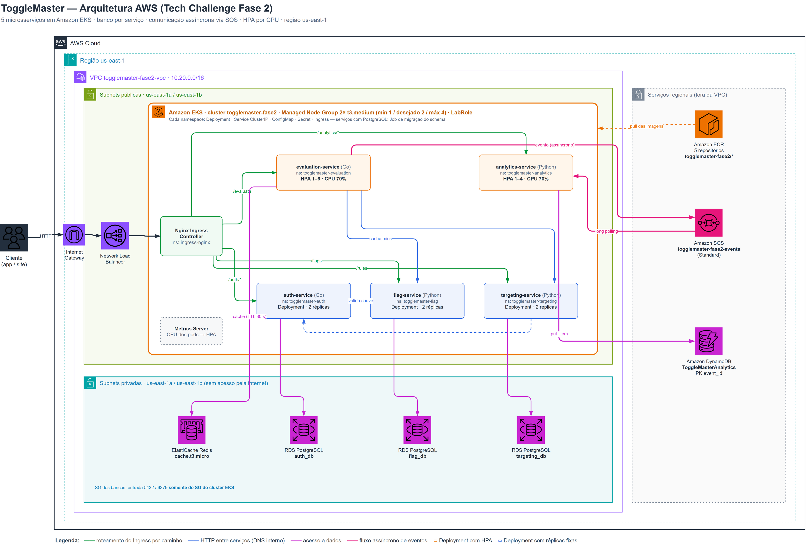

| Serviço | Responsabilidade | Dados | Rota no Ingress | Réplicas |
|---|---|---|---|---|
| auth-service (Go) | Emite e valida chaves de API | RDS `auth_db` | `/auth/*` | 2 |
| flag-service (Python) | CRUD das feature flags | RDS `flag_db` | `/flags` | 2 |
| targeting-service (Python) | Regras de segmentação | RDS `targeting_db` | `/rules` | 2 |
| evaluation-service (Go) | Decisão final `true/false` (caminho quente) | Redis + SQS (produtor) | `/evaluate` | HPA 1–6 |
| analytics-service (Python) | Consome eventos e grava para análise | SQS (consumidor) + DynamoDB | `/analytics/*` | HPA 1–4 |

### Recursos provisionados na AWS (us-east-1)

| Recurso | Configuração |
|---|---|
| VPC | `10.20.0.0/16`, própria da Fase 2; 2 subnets públicas e 2 privadas em AZs diferentes, sem NAT Gateway |
| EKS | Cluster `togglemaster-fase2`, Kubernetes 1.37, criado pelo **console**, Cluster Role = **`LabRole`** |
| Managed Node Group | `togglemaster-fase2-nodes`, 2× `t3.medium` (Amazon Linux 2023), **mínimo 1, desejado 2, máximo 4**, Node Role = **`LabRole`** |
| ECR | 5 repositórios `togglemaster-fase2/<serviço>`, imagens com a tag `v1` |
| RDS | 3 instâncias PostgreSQL 16 (`db.t3.micro`, 20 GB, Single-AZ) em subnets privadas, sem acesso público |
| ElastiCache | 1 cluster Redis 7.1 (`cache.t3.micro`) em subnets privadas |
| DynamoDB | Tabela `ToggleMasterAnalytics`, chave de partição `event_id`, capacidade sob demanda |
| SQS | Fila Standard `togglemaster-fase2-events` |
| No cluster | Metrics Server v0.7.2 e Nginx Ingress Controller v1.12.1 (provider AWS → NLB) |

Os Security Groups do RDS e do ElastiCache aceitam conexões **somente do Security Group do cluster
EKS** (referência a Security Group, não a faixa de IP, o mesmo princípio aplicado na Fase 1).

### Manifestos Kubernetes

Cada serviço tem o seu diretório em `k8s/base/<serviço>/` e o seu **namespace**
(`togglemaster-auth`, `togglemaster-flag`, …), com:

- **Deployment** com imagem do ECR, **requests e limits**, **readiness e liveness probes** em `/health`,
  execução como usuário não-root e sem capabilities do Linux;
- **Service** do tipo `ClusterIP`;
- **ConfigMap** com URLs internas, portas e região;
- **Secret** (base64) com strings de conexão, chaves e endpoints dos recursos AWS. Os valores reais
  são gerados por script a partir dos recursos provisionados e **nunca vão para o Git**;
- **Ingress** com roteamento por caminho, todos atrás do mesmo Load Balancer;
- **HorizontalPodAutoscaler** por CPU (alvo 70%) no evaluation-service e no analytics-service;
- **Job de migração** do schema nos serviços com PostgreSQL, separado do processo web. É a correção
  do débito do fator XII do 12-Factor apontado na Fase 1.

---

## 5. Requisitos atendidos

| Requisito do enunciado | No repositório | No vídeo |
|---|---|---|
| Dockerfile otimizado (multi-stage) para os 5 serviços | `services/*/Dockerfile` | 2:42 |
| `docker-compose.yml` com 5 apps + 2 PostgreSQL + Redis + DynamoDB Local | `docker-compose.yml` | 2:42 |
| Cluster EKS pelo console com `LabRole` | `docs/01-arquitetura.md` | 4:15 |
| Managed Node Group com Auto Scaling 1/2/4 e `LabRole` | `docs/01-arquitetura.md` | 4:15 |
| 5 repositórios ECR com as imagens publicadas | `scripts/aws/02-publicar-imagens-ecr.sh` | 4:15 |
| 3 RDS PostgreSQL, 1 ElastiCache Redis, 1 DynamoDB, 1 SQS Standard | `scripts/aws/03-provisionar-recursos.sh` | 4:15 |
| Metrics Server e Nginx Ingress Controller | `scripts/aws/05-preparar-cluster.sh` | 6:20 · 8:13 |
| Namespace, Deployment, Service ClusterIP, Secret e ConfigMap por serviço | `k8s/base/<serviço>/` | 6:20 |
| Ingress com roteamento por caminho, chamado pela URL do Load Balancer | `k8s/base/*/ingress.yaml` | 6:20 |
| Requests/limits, readiness e liveness probes | `k8s/base/*/deployment.yaml` | 6:20 |
| HPA por CPU no evaluation-service, com carga gerada pelo `hey` | `k8s/base/evaluation-service/hpa.yaml` | 8:13 |
| Mensagens enviadas manualmente ao SQS e HPA do analytics-service escalando | `k8s/base/analytics-service/hpa.yaml` | 10:09 |
| Dados aparecendo na tabela do DynamoDB | `scripts/aws/demo/ver-dynamodb.sh` | 10:09 |
| Justificativa da escalabilidade do analytics-service (HPA x KEDA) | Seção 7 | 11:51 |
| Diferença de propósito entre RDS, ElastiCache e DynamoDB | Seção 8 | 11:51 |
| Arquitetura e desafios encontrados (limitações da `LabRole`) | Seções 4 e 9 | 0:41 e 13:33 |

### Roteiro do vídeo

| Início | Bloco | Narração |
|---|---|---|
| 0:00 | Abertura | Lucas |
| 0:41 | Arquitetura (diagrama) | Rafael |
| 2:42 | Ambiente local com Docker Compose (9 contêineres) | Lucas |
| 4:15 | Infraestrutura na AWS (EKS, node group, ECR, RDS, ElastiCache, DynamoDB, SQS) | Rafael |
| 6:20 | Pods, Ingress e teste pelo Load Balancer | Lucas |
| 8:13 | Escalabilidade: HPA do evaluation-service sob carga | Rafael |
| 10:09 | Fila SQS, HPA do analytics-service e dados no DynamoDB | Lucas |
| 11:51 | Por que cada escolha (RDS x ElastiCache x DynamoDB; HPA x KEDA) | Rafael |
| 13:33 | Desafios e encerramento | Lucas |

---

## 6. Evidências

Telas capturadas da gravação da demonstração (29/10/2026).

### 6.1 — Ambiente local: 9 contêineres no ar

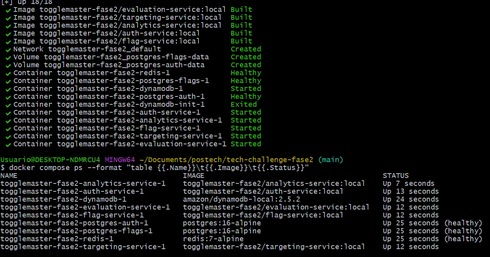

*`docker compose up --build`: os 5 serviços, 2 PostgreSQL, Redis e DynamoDB Local rodando (o
`dynamodb-init` é um contêiner auxiliar que cria a tabela e encerra).*

### 6.2 — Cluster EKS e node group

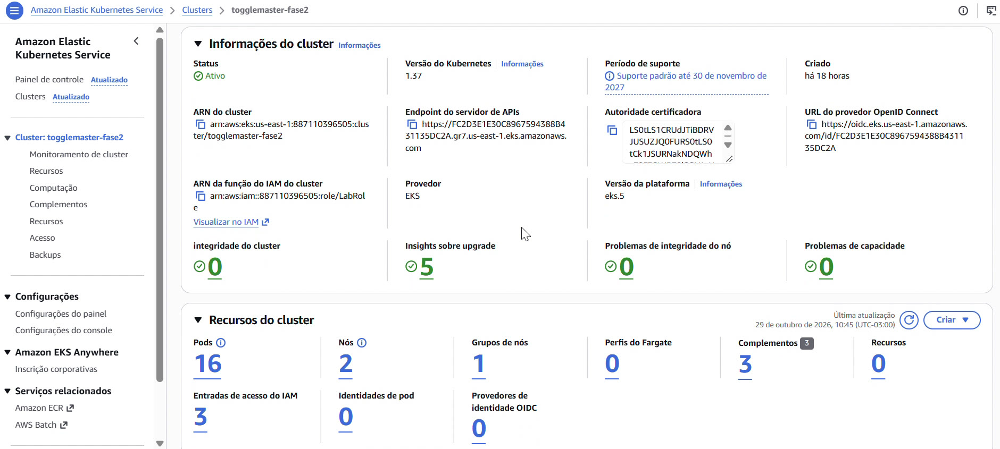

*Cluster `togglemaster-fase2` ativo, com a `LabRole` como role do cluster: 16 pods em 2 nós.*

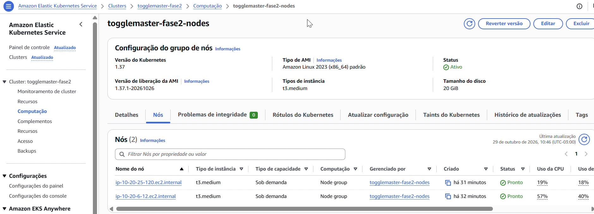

*Managed Node Group com 2 nós `t3.medium` prontos (configuração de escala 1/2/4).*

### 6.3 — Registro de imagens e rede

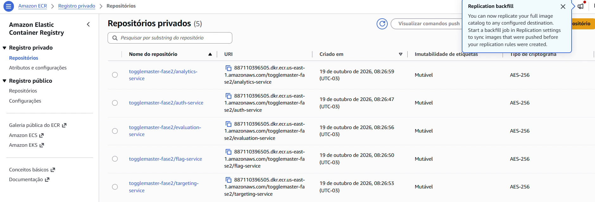

*Os 5 repositórios do ECR, um por microsserviço.*

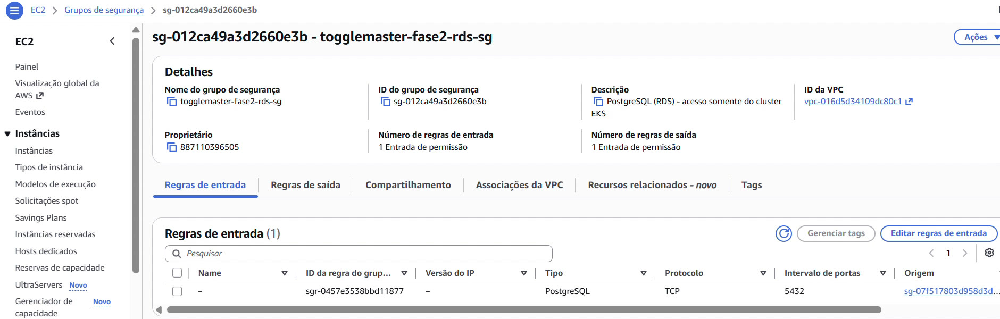

*Security Group do RDS: uma única regra de entrada, porta 5432, com origem no Security Group do
cluster EKS.*

### 6.4 — Pods, Ingress e teste pelo Load Balancer

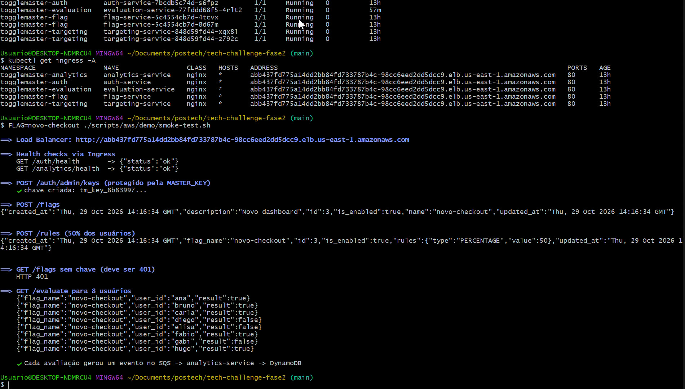

*Pods dos 5 serviços em execução, os 5 Ingress apontando para o mesmo NLB e o teste do fluxo
completo pela URL do Load Balancer: health checks, criação de chave, flag com regra de 50%, recusa
sem chave (HTTP 401) e avaliação para 8 usuários.*

### 6.5 — HPA do evaluation-service sob carga

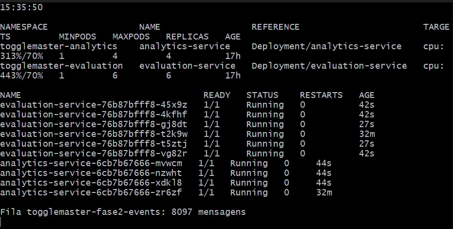

*Durante a carga: evaluation-service em **6 réplicas** (CPU a 443% do request contra alvo de 70%) e,
em cadeia, analytics-service em **4 réplicas** com 8.097 mensagens na fila.*

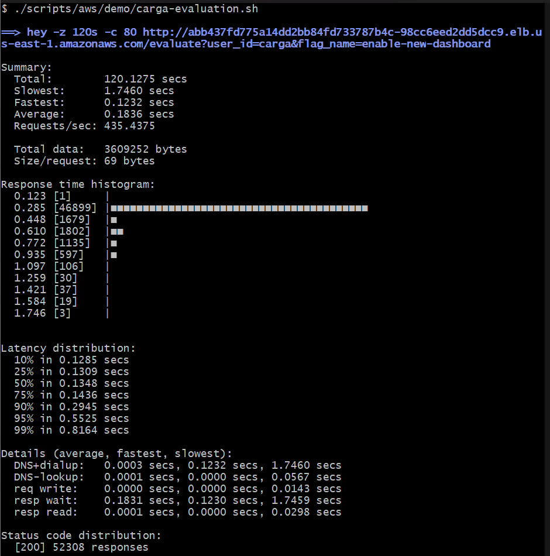

*Resumo do `hey -z 120s -c 80`: 52.308 requisições, todas com HTTP 200, 435 req/s, mediana de
0,135 s.*

### 6.6 — SQS, HPA do analytics-service e DynamoDB

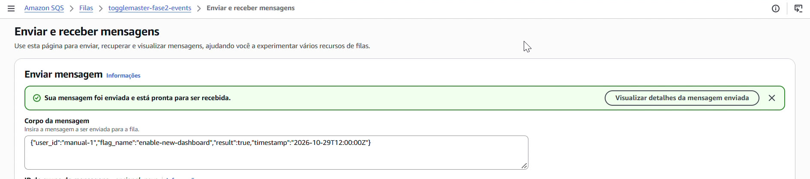

*Mensagem enviada manualmente pelo console do SQS, com `user_id` = `manual-1`. Em seguida, mais
20.000 mensagens foram enviadas por script para gerar carga.*

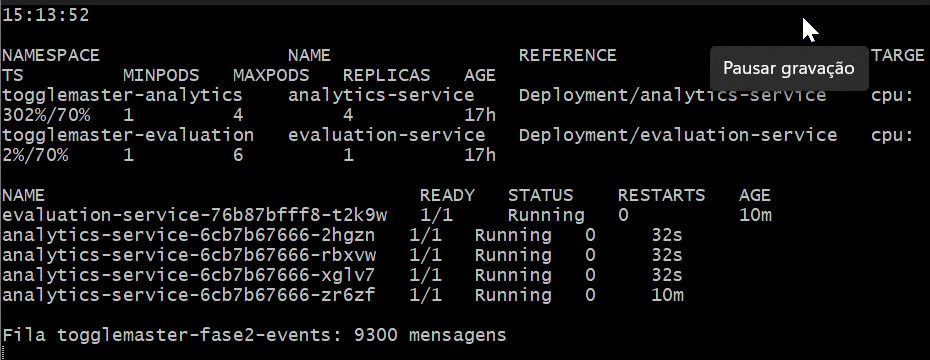

*Com a fila cheia, a CPU do analytics-service vai a 302% do request e o HPA sobe de 1 para
**4 réplicas**. Em 15 segundos a fila cai de 17.040 para 9.300 mensagens.*

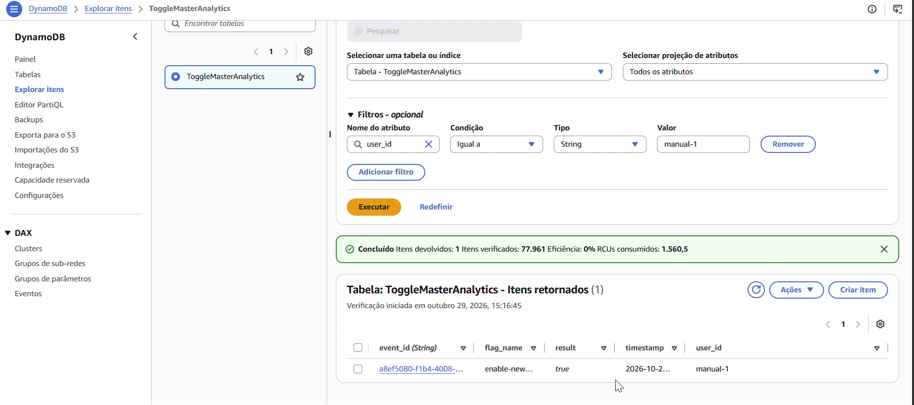

*A mensagem `manual-1` gravada pelo analytics-service na tabela `ToggleMasterAnalytics`, entre
77.961 itens gerados ao longo da demonstração.*

---

## 7. Escalabilidade

| Serviço | Réplicas | Mecanismo |
|---|---|---|
| auth, flag, targeting | 2 fixas | Alta disponibilidade, uma réplica por nó |
| evaluation-service | 1 a 6 | HPA por CPU, alvo 70% |
| analytics-service | 1 a 4 | HPA por CPU, alvo 70% |

O **Metrics Server** coleta o uso de CPU de cada pod e o HPA compara com o `request` de CPU do
container para decidir quantas réplicas manter.

### Resultado medido na AWS

| Medida | Resultado |
|---|---|
| Carga | `hey -z 120s -c 80` em `/evaluate`, pela URL do Load Balancer |
| Requisições | 52.308, **todas com HTTP 200** |
| Vazão | 435 req/s |
| Latência | mediana 0,135 s · p90 0,295 s · p99 0,816 s |
| evaluation-service | **1 → 6 réplicas** (o máximo do HPA) |
| analytics-service | **1 → 4 réplicas**, sem nenhuma carga direta, só pelos eventos que chegaram à fila |
| Mensagens manuais (20.000 no SQS) | analytics-service de **1 → 4 réplicas** de novo, consumindo ≈ 500 mensagens/s |

A cadeia observada confirma o desenho assíncrono: a carga no evaluation-service vira eventos no
SQS, e o analytics-service escala para dar conta deles **sem atrasar nenhuma resposta** ao cliente.

### Por que HPA por CPU no analytics-service, e não KEDA

O ideal para um consumidor de fila é escalar pelo **tamanho da fila**, o que o KEDA faz (inclusive
reduzindo a zero réplicas quando a fila está vazia). Mas o KEDA precisa ler as métricas do SQS com
uma IAM Role própria (IRSA ou Pod Identity), e **o AWS Academy não permite criar roles**.

A alternativa adotada usa o fato de que a CPU do consumidor acompanha a fila: com mensagens
acumuladas, o worker processa sem pausa e a CPU sobe; com a fila vazia, ele fica bloqueado no long
polling e a CPU cai. A demonstração comprovou o comportamento: com 17.040 mensagens na fila, a CPU
chegou a 302% do request e o HPA subiu para 4 réplicas.

**Limitações reconhecidas:** a reação é indireta (o HPA só age depois que a CPU sobe) e o mínimo é
1 réplica, nunca zero. Numa conta com IAM completo, o próximo passo é um `ScaledObject` do KEDA
monitorando `ApproximateNumberOfMessages`.

---

## 8. Os três data stores e seus propósitos

| | RDS PostgreSQL | ElastiCache Redis | DynamoDB |
|---|---|---|---|
| **Modelo** | Relacional, SQL, transações ACID | Chave-valor em memória | NoSQL chave-valor |
| **Papel no ToggleMaster** | Fonte da verdade de chaves, flags e regras | Cache do caminho quente | Histórico de eventos de avaliação |
| **Por quê** | Dados pequenos e críticos, com unicidade e integridade | Latência abaixo de 1 ms; dado descartável (TTL de 30 s) | Muita escrita só de inserção, sem joins; escala sem administrar servidor |
| **Se perder os dados** | Perda real (configuração do produto) | Só alguns cache misses | Perda de histórico, sem afetar a operação |

Em resumo: o **RDS guarda o que é verdade**, o **Redis guarda o que é rápido** e o **DynamoDB guarda
o que é volumoso**.

Cada serviço com estado relacional tem o **seu próprio RDS**, e nenhum serviço lê o banco de outro: o
evaluation-service obtém flags e regras pelas APIs, nunca por SQL. Isso permite evoluir o schema,
escalar e até trocar o banco de um serviço sem coordenar com os outros, o oposto do acoplamento do
monolito da Fase 1.

---

## 9. Desafios encontrados e decisões tomadas

### 9.1 — A `LabRole` não permite criar IAM Roles

**Desafio.** No AWS Academy não é possível criar roles. Isso elimina o `eksctl create cluster`, o
IRSA/Pod Identity, o KEDA, o Karpenter e o AWS Load Balancer Controller.

**Decisão.** Cluster e node group criados pelo console com a `LabRole`; Load Balancer criado pelo
Nginx Ingress Controller com o controlador nativo do Kubernetes (NLB); HPA por CPU no lugar do KEDA
(seção 7).

**Limitação reconhecida.** Todos os pods herdam a `LabRole` do nó, ou seja, qualquer pod pode acessar
SQS e DynamoDB. Em produção, cada serviço teria a sua role por ServiceAccount (IRSA), com privilégio
mínimo.

### 9.2 — Pods sem credenciais da AWS (IMDSv2 com *hop limit* 1)

**Desafio.** Com tudo implantado, o evaluation-service registrava `NoCredentialProviders` e o
analytics-service `Unable to locate credentials`. Nenhum evento chegava ao SQS.

**Causa.** Os nós do EKS nascem com o serviço de metadados (IMDSv2) limitado a **1 salto de rede**.
O próprio nó alcança as credenciais da `LabRole`, mas o pod, que está um salto adiante (a rede do
container), não.

**Decisão.** Subir o *hop limit* para 2 em cada nó (`modify-instance-metadata-options`). A correção foi
automatizada nos scripts `05-preparar-cluster.sh` e `nodes.sh ligar`, para valer também para nós
recriados. Em produção, IRSA/Pod Identity dispensa o acesso dos pods aos metadados.

### 9.3 — Fim da sessão do Lab com o node group ligado

**Desafio.** Depois de uma sessão encerrada, o Auto Scaling Group recriou nós que **nunca entraram no
cluster**.

**Causa.** Com o Lab encerrado, as permissões ficam bloqueadas por uma política da organização
(`ec2:DescribeInstances` negado). A instância criada nesse intervalo falha na inicialização e fica
quebrada mesmo depois que a sessão volta.

**Decisão.** Criamos o `nodes.sh`: `desligar` reduz o node group a 0 nós antes do *End Lab*, e `ligar`
volta a 1/2/4, aplica a correção do item 9.2 e reinicia os serviços. As instâncias que já haviam
nascido quebradas foram encerradas para o node group criar outras.

### 9.4 — Código-fonte original não compilava

**Desafio.** Os serviços recebidos não rodavam como estavam.

**Decisão.** Correções mínimas, todas listadas no `README.md`: `go.mod` com módulo inexistente e
imports inválidos nos serviços Go; Flask 2.2.2 incompatível com Werkzeug 3.x e gunicorn 20.1.0
dependente de `pkg_resources` (o mesmo problema já visto na Fase 1); boto3 antigo demais para apontar
para o DynamoDB Local. A lógica de negócio não foi alterada.

### 9.5 — `runAsNonRoot` recusando as imagens Go

**Desafio.** As imagens `distroless` declaram `USER nonroot`, pelo nome. O Kubernetes recusava
iniciar os pods com `runAsNonRoot: true`, porque não consegue verificar um nome de usuário, só o UID.

**Decisão.** `USER 65532:65532` (o UID numérico do mesmo usuário). As imagens Go ficaram com ≈ 20 MB,
sem shell nem gerenciador de pacotes.

### 9.6 — Crédito de US$ 50 para o curso inteiro

**Desafio.** O ambiente completo custa ≈ US$ 7,60 por dia ligado.

**Decisão.** Validar tudo localmente antes de gastar crédito: Docker Compose e um cluster **kind** com
os mesmos manifestos do EKS, onde o HPA foi testado primeiro. Na AWS, a infraestrutura foi criada por
scripts, demonstrada, gravada e **destruída** por script (`99-destruir.sh`). Uma sessão de 4 horas
custa ≈ US$ 1,30.

---

## 10. Estimativa de custos

Detalhamento em [`02-estimativa-custos.md`](02-estimativa-custos.md). Preços on-demand em us-east-1.

| Componente | US$/mês |
|---|---:|
| EKS (plano de controle) | 73,00 |
| EC2 (2× t3.medium) + EBS | 63,94 |
| RDS (3× db.t3.micro + armazenamento) | 46,32 |
| Network Load Balancer | 20,81 |
| IPv4 públicos (4) | 14,60 |
| ElastiCache (cache.t3.micro) | 12,41 |
| DynamoDB, SQS e ECR (volume da demonstração) | < 0,20 |
| **Total** | **≈ 231** |

O plano de controle do EKS é o maior item (≈ 32%) e não depende de carga. Ficar **sem NAT Gateway**
(nós em subnets públicas, banco e cache em subnets privadas) economiza ≈ US$ 33/mês.

---

## 11. Referências

- [Código-fonte dos microsserviços — FIAP-TCs](https://github.com/FIAP-TCs)
- [Amazon EKS — Managed Node Groups](https://docs.aws.amazon.com/eks/latest/userguide/managed-node-groups.html)
- [Kubernetes — Horizontal Pod Autoscaling](https://kubernetes.io/docs/tasks/run-application/horizontal-pod-autoscale/)
- [Ingress-Nginx Controller — instalação na AWS](https://kubernetes.github.io/ingress-nginx/deploy/#aws)
- [KEDA — AWS SQS Queue scaler](https://keda.sh/docs/latest/scalers/aws-sqs/)
- [Amazon EC2 — Instance Metadata Service (hop limit)](https://docs.aws.amazon.com/AWSEC2/latest/UserGuide/configuring-IMDS-existing-instances.html)
